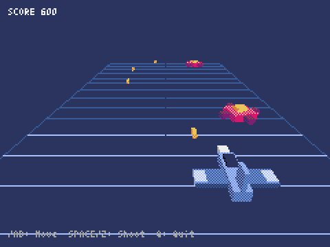

# Shooter 

## Introduction

A shooter game.

## How to Play

Please execute the following from the Pyxel (version 3.0.1) environment.
Or you can play [here](https://kitao.github.io/pyxel/wasm/launcher/?run=jay-kumogata.Kumamoto.pyxel.shooter.shooter).

	> python shooter.py

## Remarks

This code was automatically generated by Grok4.5.
